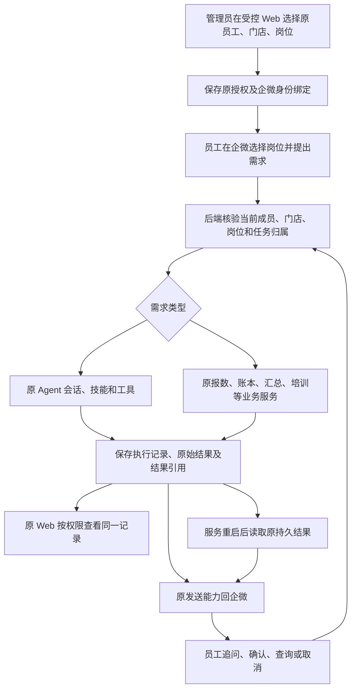

# Frontagent Claw 产品闭环 PRD

版本：v1.0 待产品确认；日期：2026-10-30。

本文描述最小重接后的目标使用方式，不代表已经上线。执行范围继续沿用[最小重接计划](frontagent-baseline-and-reconnect-plan.md)，不自动新增开发任务或生产授权。R1/R2 基线为 `c7b7b1b`；2026-10-30 R3 已通过原状态单员工营销的本地隔离执行、离线回复与重启查回，真实模型及企微实收仍待验。

## 1. 产品定位与完成标准

Frontagent Claw 是美容门店内部的多岗位、多技能工作助手。员工在企微提出需求、补充材料、确认业务、接收结果并查回；管理员在原 Web 管理开通、资料、岗位配置、复杂操作和审计。两端使用同一套原业务事实、账号和权限，不各建一套账本或 Agent。

产品闭环定义为：**可信员工提出需求 → 当前门店与岗位授权 → 原 Agent／业务服务完成操作 → 结果持久保存 → 企微反馈真实状态 → Web 在权限内查看同一事实 → 重启后仍可查回 → 异常有明确下一步。**

“机器人收到消息”“模型输出了一段文字”“平台接受发送请求”分别只是中间状态，不能单独算业务完成。

## 2. 用户、入口与权限

| 角色／界面 | 主要操作 | 权限要求 |
| --- | --- | --- |
| 员工／企微机器人 | 选择已授权岗位、自然语言任务、追问、报数、确认、查询、取消、获取报告文件 | 使用本人原账号、当前门店和当前岗位授权；任务及结果按原归属隔离 |
| 店长／企微及受控 Web | 在授权门店内查看经营数据、业务记录与异常，处理职责范围内事项 | 店长身份不自动获得其他门店或员工私有会话读取权 |
| 管理员／受控 Web | 绑定成员、选择门店和岗位、开通／撤权、管理原知识技能与模型配置、审计和宿主维护 | 宿主管理权与私有内容读取权分开；恢复宿主不赋予阅读员工私人聊天的权限 |
| 公网展示站 | 项目介绍、功能说明、脱敏截图、预录演示 | 与业务后台分开；不提供注册、登录、在线体验或业务 API／WebSocket |

受控 Web 的使用以内部访问通道为前提，本 PRD 不重新开放原公网 CRM。员工正常日常流程不得要求跳转 Web 才能完成确认、取消或查回。复杂文件编辑、配置和审计保留在原 Web；这类管理工作不承诺全部聊天化。

顾客咨询、预约等原能力保留，但顾客入口沿用原微信客服／预约链路，分别验收。员工智能机器人不能被描述为顾客直接咨询入口；本 PRD 不新增顾客渠道。

## 3. 整体路径

后端继续运行一个原完整 Native 宿主及原 Agent 执行循环。Web 和企微均通过原服务读取或操作数据；通知状态可以独立存储，但必须引用同一业务结果。

身份链固定为“当前企业／机器人／成员 → 原账号 → 所属租户、实例、门店 → 当前岗位及本人工作间”。企业、租户、门店或实例标识不能由员工文本或模型输出改写；同名员工、同名门店和其他机器人消息不能按名称自动合并身份。

## 4. 管理员开通与资料维护

### 4.1 首次开通

1. 管理员通过受控通道登录已有 Frontagent Claw Web，使用原管理员账号。
2. 选择已有员工、门店和岗位，核对企微可信成员与原账号的对应关系。
3. 后端验证原 Profile、工作间、技能和资料来源，保存当前授权与绑定版本。
4. 已有岗位资源齐全时直接复用，员工不再次安装技能、配模型或创建账号。重复开通不产生第二套岗位或工作间。
5. 原技能文件缺失或来源无法确认时，显示具体不可用原因；保留原配置，不以同名新资源替代原资源，也不显示“全部开通成功”。

### 4.2 变更与撤权

改店、停用、撤权后，后端在新的操作及结果交付前重新检查当前授权。旧卡片、历史会话和模型文本不能恢复旧权限。正在执行的任务按原精确取消能力处理；若尚未证实停止，应显示“停止处理中／待核对”，不能承诺已中止外部动作。

已有结果不删除。撤权后能否读取某条历史结果仍按当前原结果权限判断，不能仅因曾参与任务而继续读取。

### 4.3 知识、技能及配置

管理员继续在原页面维护岗位资料和原技能配置。员工只使用当前授权范围内的有效资料；能生成草稿不代表能发布。模型、工具、插件和 MCP 的实际能力来自原装配及执行检查，不由岗位名称推定。

## 5. 员工主流程

以下内容是交付目标和验收示例，不能当作当前已开放的使用承诺。

### 5.1 选择岗位与自然语言工作

示例：B 店员工选择“内容营销”，发送“根据本周已审核活动写三条朋友圈文案，不要编造价格”。

1. 企微消息进入渠道适配，后端核验成员并解析其当前授权；消息自身不能指定其他员工身份。
2. 后端解析该员工当前选择的原岗位与会话。未选岗位时提示选择；不把任意文本都推定为报数。
3. 已成功持久受理后，返回可查回的受理编号。未保存成功不能回复“已受理”。重复渠道消息引用原受理记录。
4. 原 Agent 在该工作间中使用原会话、已授权资料、技能和工具执行。资料不足时指出缺什么；工具失败时返回实际失败，不能编造已执行。
5. 后端保存完整答案、原执行引用、依据及可用附件引用，再创建或更新对应回复意图。
6. 企微收到完整结果；超出单条承载时沿用已验证的分段／分页或文件交付方式，并保留受理编号供查询。不能把截断摘要当完整交付。
7. Web 在相应权限下显示同一任务或业务结果；管理员的默认审计视图仅显示其获准的状态、来源、时间和引用，不因此公开员工私有提示词、资料或聊天内容。

输出文案是“草稿”。自动发布、对顾客外发、预约或账务写入等动作，必须有该动作已有权限和原确认流程；本链路不新增自动执行权。

### 5.2 连续追问与多技能

员工继续发送“第二条改得更口语一点，活动条件不变”。后端将其交给当前明确选中的原会话，保存新的输入与结果引用，不覆盖已保存的前一轮结果。

一项需求可由原 Agent 使用多个现有技能；不为每个技能建立新机器人、账号或调度器。执行中的补充要求沿用原排队／取消规则，不承诺必然中途改写正在运行的那一轮。切换岗位后明确当前上下文，不跨岗位或跨员工自动合并私人记忆。

当员工发起新的独立工作，应使用原有新会话方式；若需求归属不明确，先确认目标会话再继续。新会话的人类可读提示沿用原能力适配，不在本文新增命令语法。

同一员工存在多项未结束工作时，查询、取消和修改必须定位到明确的受理编号或当前唯一会话；无法判断“上一条／第二条”指向哪个任务时先澄清，不按最近完成时间猜测。渠道重复投递同一输入只产生一次受理；新的一轮追问保留自己的输入及结果引用。

### 5.3 报数、确认、更正和经营汇总

1. 员工在企微明确报数，后端按原确定性规则解析期间和金额，生成待核对报告。
2. 企微展示金额、期间、销售口径、报告编号和确认入口。待核对不计入已确认经营指标。
3. 本人或原规则允许的确认者核对后确认；后端重新验证权限和报告版本，通过原事务入账。
4. 账本提交成功才反馈“已入账”。重复消息、重复点击或并发确认只能产生一次有效提交。
5. 更正引用原报告及版本，保留原记录、修改原因和变更关系；版本冲突时返回当前状态供重新核对，不能悄悄覆盖。
6. 经营汇总和 Excel 从同一原账本按当前门店与权限生成。销售成交、实收、充值及余额消耗不能混算；报告需明确期间、单位和口径。
7. Web 刷新后显示同一确认或更正结果。通知失败不能回滚已入账事实，也不能让员工重新报数来补通知。

### 5.4 其他岗位与培训

客服接待、前台办理、投放辅助、店长经营、评测质检和培训继续保留原能力，按岗位逐项开放。培训答案和教案使用原资料及引用；未知门店政策、缺资料和过期证据需明确说明。

每个岗位只有完成其真实输入、原技能／工具、持久结果、企微交付与查回验收后才显示可用。首个内容营销岗位通过，不代表其余岗位同时通过。

### 5.5 查询与取消

员工在企微按受理编号或原报告／任务编号查询，后端重新授权后读取原持久状态。查询已完成任务不能再次运行 Agent；编号本身不授予读取权。

取消请求必须关联原执行对象。尚未执行的任务可按原规则取消；执行中的任务只有收到原运行器的停止证据后才显示“已停止”。取消不自动撤销此前已提交的账务或外部动作。

## 6. Web 与后端数据如何闭合

| 数据／事实 | 企微呈现 | Web 呈现 | 后端要求 |
| --- | --- | --- | --- |
| 账号、成员、门店、岗位 | 当前可用岗位和拒绝原因 | 原管理员开通、变更和授权状态 | 复用原账号与授权；可信绑定和当前版本校验 |
| 会话、输入、执行 | 受理编号、进度、追问和取消 | 原有权限内的任务视图或必要审计引用 | 原会话与原执行一一关联，保留输入及终态 |
| 答案、草稿、附件 | 完整答案、来源、草稿状态、查询入口 | 在内容读取权限内查看相同版本 | 先保存原结果，再投递；附件按同一权限获取 |
| 报数与账本 | 待核对、确认、更正、汇总和文件 | 原报告、账本与变更记录 | 单一口径、原事务、去重和版本约束 |
| 通知 | 已返回、可查询、失败或未知的提示 | 原可观察通知状态与处理记录 | 区分提交与发送；重发不重做业务 |
| 记忆与知识 | 在授权任务中使用可用内容 | 原资料和记忆管理页 | 不默认把所有企微聊天变成共享知识，不跨用户泄漏 |

“同一数据”指两端引用同一业务对象、结果版本和授权事实，不要求重建或合并现有不同用途的 SQLite 文件。原账本、会话存储和通知状态继续使用各自职责；跨存储投递由已有恢复与通知机制协调，不假装天然是一个跨库事务。

普通员工不因 Web 数据可见性而被迫使用 Web；业务负责人查看业务记录，不自动获取员工私人会话。没有现成授权任务详情页时，先通过原业务视图和审计引用对账，不在最小重接中新增通用管理看板。

## 7. 状态和异常

以下是产品呈现语义，应映射到原持久状态，不要求新建统一状态引擎。

| 情况 | 员工看到什么／如何处理 | 后端与 Web 应保持什么事实 |
| --- | --- | --- |
| 已受理／执行中 | 编号与实际进度；可查询或请求取消 | 已受理必须已保存；进度来自原任务，不能伪造百分比 |
| 待确认 | 原摘要和确认操作 | 业务尚未提交，模型文字不能代为确认 |
| 执行失败／模型不可用／额度不足 | 实际原因及可行下一步 | 未成功的动作不报成功；重新执行需明确新请求与副作用边界 |
| 业务完成、通知失败 | 有通道时提示可查回；恢复后以编号查询 | 原结果保留，后续仅处理通知，不重跑业务 |
| 发送结果未知 | 不盲目重发；员工主动查询已保存结果 | 保留未知状态，不冒充已送达，也不重新生成答案 |
| 失权、错误门店、错误任务归属 | 拒绝操作，指明联系管理员核对授权 | 不泄漏其他人的内容，旧卡片不能沿用旧权限 |
| 旧任务是否执行过不明 | 标记待人工核对 | 保留原记录，暂停自动续跑；不自行算成功或取消 |
| 服务维护或渠道断开 | 通道可用时明确提示；恢复后查询编号，没取得受理号的先核实是否受理 | 不承诺可靠离线收件箱；不得默默丢单后回复已受理 |
| 重启 | 员工仍能查询原结果 | 原结果不重建、不重复入账、不自动重发未知回复；先通过原恢复流程 |

平台发送接受回执不等于员工实际阅读。业务完成、平台回执和员工验收分别记录。长连接、文件发送和平台有效期必须通过真实渠道验收，不能根据本地合成通过作承诺。

## 8. 首批交付与逐岗开放

| 批次 | 内容 | 开放条件 |
| --- | --- | --- |
| G0 正确原数据恢复 | 原管理员、员工、岗位、资料；原 T7 恢复 | 原数据不被替代，旧任务按已确认规则处置，完整宿主合法恢复 |
| G1 单成员多技能试点 | B 店指定员工、内容营销；需求、追问、取消、完整答案与重启查回 | 在正确原数据上完成真实容器组合，再做少量真实模型和指定成员实测 |
| G2 经营业务闭环 | 报数、确认、更正、汇总、Excel；企微与原 Web 对账 | 原账本零重复提交，口径正确，文件真实收到，跨门店拒绝 |
| G3 其余原岗位 | 培训及其他岗位、原复杂 Web 管理 | 每岗原资源来源完整、权限与正反例通过；未通过岗位明确不可用 |

G1 与 G2 都通过才可把首批产品称为“员工助手与经营业务闭环可用”；G3 逐岗验收后才承诺全部原岗位可用。公网展示页不因这些批次通过而自动开放业务入口。

文本入站是本次已核实的接线基础。图片、语音、员工上传附件、自动发布等能力均须单独确认接线及验收，不能由 Excel 出站或原 Web 文件能力推定已经支持；原代码和资料继续保留。

## 9. 验收清单

验收使用门店授权准备好的正常与异常样例，保留请求、执行、业务结果和通知的关联证据；以下必测项需逐项通过，不用接口健康或测试数量代替。

| 编号 | 验收场景 | 可观察通过条件 |
| --- | --- | --- |
| AC01 | 原管理员开通原员工，重复开通 | 员工能选已有岗位，账号／Profile／工作间无重复创建 |
| AC02 | 自然语言与连续追问、多技能 | 原会话执行，依据可追溯，新旧结果可区分，企微收到完整答案 |
| AC03 | 报数及重复确认 | 一份有效报告只提交一次；企微查询与 Web 刷新、原账本一致 |
| AC04 | 更正、汇总及 Excel | 原版本与更正关系保留；摘要、Web 和文件的期间与口径一致 |
| AC05 | 权限隔离与撤权 | 跨用户／门店／岗位、失效绑定、旧卡片及交付前撤权均不泄漏或越权 |
| AC06 | 精确取消 | 仅目标执行被停止；无停止证据不显示已停止；已提交动作保留真实状态 |
| AC07 | 资料缺失、模型／工具失败 | 明确缺口或失败，不虚构来源、政策、发布、入账或预约成功 |
| AC08 | 通知失败与未知 | 业务结果仍可查回；恢复通知不再次调用模型或执行业务；未知不盲重发 |
| AC09 | 两个独立进程重启 | 第二进程读取原结果，原记录及归属不变，无重执行、重复入账或未知回复重发 |
| AC10 | 管理与内容隔离 | 管理员可维护恢复宿主，但不能因此读取员工私有会话；授权业务视图能对账 |
| AC11 | 恢复票据与旧记录 | 配置变化使旧票据失效；原未知任务保留待核对；不绕过 T7 |
| AC12 | 指定成员真实试点 | 员工手机实际操作并查回；分别确认模型结果、平台回执及员工实收 |

试点验收门槛：上述适用必测项全部通过；越权读取、重复入账、伪造成功和未授权外发均为 0。记录受理耗时、完整结果耗时、通知失败及未知次数、员工完成任务所需操作；延迟体验阈值依据真实试点测量后确认，当前不承诺未测得的秒级 SLA。

## 10. 当前进度与工程对应

| 接点 | 沿用能力 | 当前边界（2026-10-30） |
| --- | --- | --- |
| 正确产品和原身份 | R1、R2；原管理员、员工、B 店授权及绑定 | 已有本地恢复与读取证据，不等于真实员工完整可用 |
| 岗位与会话 | D1、D2；原 Profile／工作间与输入受理 | 接线保留，在最终正确宿主上继续验收 |
| 执行、追问、取消 | D3；原 Native／Pi／队列 | 复用已有实现，原数据的完整组合仍待通过 |
| 多技能 | D4；原技能与工具装配 | 内容营销三个原技能有来源证据，其他岗位部分定义仍缺原版本证据 |
| 结果、通知、查回 | D5；原结果及持久通知能力 | 原状态单员工营销的真实容器、离线回复与第二进程查回通过；真实发送及模型效果待验，不等于 G1 全部完成 |
| 宿主恢复 | T7、R3；原扫描、票据和恢复接口 | 配置合成双进程票据验证通过；原自定义岗位和待处理记忆事件仍阻塞 |

下一步开发继续以最小重接计划为准。本 PRD 不要求新建 Agent 内核、统一数据库、通知平台、管理看板或权限框架；新增工作必须能对应到以上一个实际验收缺口。顾客链路、小程序、收费与自动外发不并入本轮。

参考：[原使用说明与工程对应](product-usage-and-engineering.md)、[D1–D5 计划](wecom-native-conversation-plan.md)、[最小重接及当前证据](frontagent-baseline-and-reconnect-plan.md)。旧说明中的阶段现状仅供追溯，当前状态以最小重接计划为准。

文档自查：已检查范围、权限、业务／通知状态、重复请求、多任务归属和验收可观察性；本次为文档自查，不作为独立工程审查或上线验收。版本仍待产品确认，不自动改变既有开发排期。
